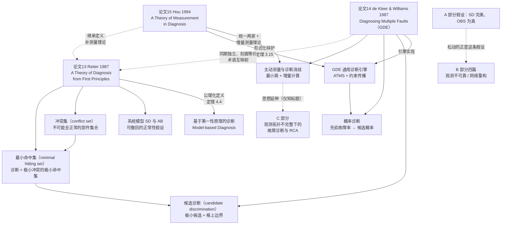
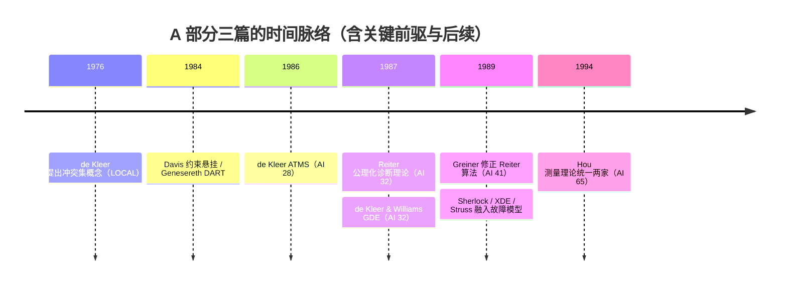

# A 经典诊断与测量理论 — 知识图谱

>A 部分三篇论文构成 model-based diagnosis 的经典骨架：**Reiter 给公理与定理，de Kleer & Williams 给引擎与概率测量，Hou 给测量的增量理论并把两家统一**。三篇共用同一个例子（三乘法器 + 两加法器电路），记号可逐条互译。

## Mermaid 总图

## 三篇速览表

| | 论文13 Reiter 1987 | 论文14 de Kleer & Williams 1987 | 论文15 Hou 1994 |
|---|---|---|---|
| **出处** | AI 32: 57–95 | AI 32: 97–130 | AI 65: 281–328 |
| **一句话** | 诊断 = 冲突集的最小命中集（公理化） | GDE：多故障增量诊断 + 最小熵选测量 | 测量的增量理论：从旧诊断算新诊断，统一两家 |
| **核心对象** | (SD, COMPONENTS, OBS)、AB、冲突集、HS-tree | 环境/支撑环境、极小冲突、极小候选、候选概率 | 测量产生的冲突集、等价类、同质诊断、cs-tree |
| **关键定理** | Thm 4.4（诊断=极小命中集）、Thm 5.7（测量三定律）、Thm 6.1（诊断=默认逻辑扩展） | 增量候选生成（§2.5，后由 Hou 证明）、最小熵准则（§4.3） | Thm 3.6/3.13（新旧冲突与诊断的合成）、Thm 3.15（顺序无关）、Thm 4.5/4.7（同质剪枝） |
| **未解决/短板** | 无概率、无"测哪里"、部件清单先验固定 | 无正确性证明、预设测量不影响设备、最坏仍指数 | 无概率与测量选择、等价类簿记开销 |
| **概念页** | [[基于第一性原理的诊断]]、[[系统模型 SD 与 AB]]、[[冲突集（conflict set）]]、[[最小命中集（minimal hitting set）]] | [[GDE 通用诊断引擎]]、[[候选诊断（candidate discrimination）]]、[[概率诊断]] | [[主动测量与诊断消歧]] |

## 核心洞察

1. **诊断是非单调推理的化身**：把"部件正常"写成可撤回假设（AB 谓词 / ATMS 环境），观测矛盾 → 撤回最少的假设。Reiter 定理 6.1 更进一步：诊断与默认逻辑扩展一一对应。这在 1987 年就把"排障"接入了当时最严肃的逻辑框架。
2. **组合化是效率的来源**：冲突集超集封闭、候选超集封闭 → 只维护两个"极小边界"。极小命中集 / 极小候选是同一个数学对象的三种写法（Reiter 定理 4.4 = GDE 候选格 = Hou 命中集计算）。
3. **测量是把诊断从"一次性分类"变成"主动实验设计"的关键**：Reiter 定理 5.7 证明测量可能**扩大**候选空间（非单调）；GDE 用最小熵把"下一步测哪里"变成可计算的期望代价；Hou 证明这一切可以只算增量。三者合起来才是完整的主动诊断循环。
4. **理论-引擎-统一的三部曲范式**：同一批人、同一个例子、互相引用修正——A 部分本身就是"如何把一个工程直觉变成科学理论"的示范。
5. **共同的最强假设 = 共同的边界**：SD 完美、部件清单先验固定、观测为真句子。B 部分松动的正是"观测为真/结构已知"；故障模型（Sherlock/XDE/Struss）松动的是"只有正确行为模型"；C 部分则处理观测与拓扑不完整。

## 对 AI 运维的映射

| A 部分概念 | AI 运维对应物 | 映射要点 |
|---|---|---|
| 系统模型 SD 与 AB | 服务依赖图 + 调用契约/SLO | SD = 拓扑与正常行为公理；AB = 服务实例异常标记 |
| 观测 OBS | 指标、日志、告警断言 | A 部分假设断言为真；实际中告警本身有噪声（→ B 部分主题） |
| 冲突集 | "这些服务不可能都健康"的证据集合 | 一次告警 + 依赖链回溯 ≈ GDE 的撞值回溯 |
| 极小候选 / 极小命中集 | 最小故障服务集合（根因假设） | 简约原则 = 根因分析里的最小故障集偏好 |
| 候选概率 + 最小熵测量 | 下一步查哪个服务 / 打哪个点 / 做哪个灰度实验 | 期望熵 = 平均剩余排查步数；先验故障率 ≈ 历史事故率 |
| 增量测量理论（Hou） | 告警风暴下的增量式 RCA | 新告警只重算被否证的根因假设，不重跑全图 |
| Reiter 测量三定律 | 新证据可能让根因集合变大 | 提醒：告警加入后候选会以"超集"形式再生，别假设只过滤 |

## 时间线

