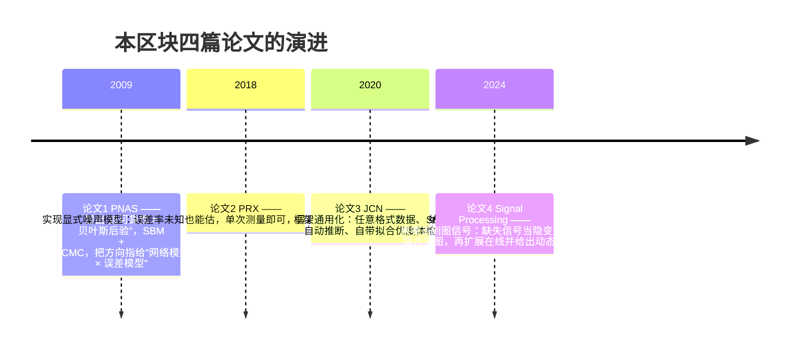

# B 网络观测不可靠、重构与不完整图信号 — 知识图谱

> 本区块回答一个问题：**拿到的网络/信号是脏的、缺的，怎么把它背后的真实结构恢复出来？**
> 四篇论文、两条路线、一个共同内核。

## 一、四篇论文速览

| # | 论文 | 年份 | 观测对象 | "不可靠"的形式 | 核心武器 | 笔记 |
|---|---|---|---|---|---|---|
| 1 | Guimerà & Sales-Pardo, PNAS | 2009 | 离散边 | 漏边 + 假边（隐式、均匀） | [[贝叶斯推断]] + [[随机块模型（SBM）]] + [[马尔可夫链蒙特卡洛]] | [[1缺失与虚假交互及复杂网络重构]] |
| 2 | Peixoto, PRX | 2018 | 离散边（可重复测量） | **未知且异质**的 $p_{ij},q_{ij}$ | (DC/HDC)SBM + 全后验共识 | [[2重构具有未知和异质误差的网络]] |
| 3 | Young, Cantwell & Newman, JCN | 2020 | **任意格式**数据 | 误差性质与大小均未知 | [[混合模型]] + [[Stan（概率编程语言）]]/HMC | [[3从不可靠数据中贝叶斯推断网络结构]] |
| 4 | Zhang & Wang, Signal Processing | 2024在线/2025卷 | **连续图信号** | 部分节点信号缺失 | [[图信号平滑性]] + [[EM算法]] + [[在线学习]] | [[4从不完整图信号中学习图：从批量到在线方法]] |

## 二、总图

```mermaid
graph TB
    BAY["贝叶斯推断：先验 × 似然 → 后验"]
    RECON["贝叶斯网络重构：生成模型 × 测量模型"]

    subgraph A1["路线一：离散的边不可靠（论文1/2/3）"]
        P1["论文1 PNAS 2009：奠基——边可靠性 = 后验概率"]
        P2["论文2 PRX 2018：未知 + 异质误差"]
        P3["论文3 JCN 2020：任意数据格式 + 自动推断"]
        SBM["随机块模型（SBM）"]
        DCSBM["DCSBM：度修正"]
        HDCSBM["HDCSBM：嵌套层次"]
        HIER["层次化的社区结构"]
        ERRP["假阴性率 p（漏报）"]
        ERRQ["假阳性率 q（误报）"]
        MMP["最大边缘后验估计（MMP）"]
        MCMC["马尔可夫链蒙特卡洛"]
        MIX["混合模型：网络解析求和掉"]
        PPC["后验预测检验：p≈0.5 才健康"]
    end

    subgraph A2["路线二：连续信号不完整（论文4）"]
        P4["论文4 Signal Processing 2025：批量 + 在线"]
        GSP["图信号处理"]
        SMOOTH["图信号平滑性"]
        EM["EM算法：E=恢复信号，M=更新图"]
        OL["在线学习：遗忘因子 ρ"]
        DR["动态遗憾：Theorem 1"]
    end

    BAY --> RECON
    P1 -- "奠基 2009" --> RECON
    P2 -- "异质未知误差 2018" --> RECON
    P3 -- "任意格式 + 自动化 2020" --> RECON
    P4 -- "换赛道：信号路线 2024" --> RECON

    P1 --> SBM
    P2 --> SBM
    P2 -- "解耦度与社区" --> DCSBM
    DCSBM -- "嵌套化" --> HDCSBM
    HDCSBM --> HIER
    P2 --> ERRP
    P2 --> ERRQ
    P2 -- "全后验共识，阈值=推导值" --> MMP
    P1 --> MCMC
    P2 --> MCMC
    P3 -- "网络求和掉，只采连续参数" --> MIX
    P3 --> PPC

    P4 --> GSP
    GSP --> SMOOTH
    P4 -- "隐变量=缺失信号" --> EM
    P4 -- "递归充分统计量" --> OL
    P4 -- "次线性才合格" --> DR

    classDef paperA fill:#d3f9d8,stroke:#2f9e44
    classDef paperB fill:#d0ebff,stroke:#1971c2
    classDef core fill:#e5dbff,stroke:#6741d9
    classDef concept fill:#fff9db,stroke:#f08c00
    class P1,P2,P3 paperA
    class P4 paperB
    class BAY,RECON core
    class SBM,DCSBM,HDCSBM,HIER,ERRP,ERRQ,MMP,MCMC,MIX,PPC,GSP,SMOOTH,EM,OL,DR concept
```

## 三、发展时间线

## 四、贯穿全区块的五个核心洞察

1. **直接把脏数据当真 = 偷偷假设了更高的可靠性**（论文2, p.16）。所有四篇的共同出发点。
2. **"没证据" ≠ "证据表明没有"**：没观测（$n_{ij}=0$）和观测为 0（$x_{ij}=0$）是两回事，难度差 $O(N^2)$ vs $O(N)$（论文2, p.13）。
3. **结构先验是拿缺失信息的货币**：误差率不是测出来的，是被**网络结构的异质性**"逼"出来的（论文2 公式39–40）；图不是测出来的，是被**信号平滑性**约束出来的（论文4）。
4. **要不确定性就采全后验（MMP/共识），要低延迟就只做 MAP（EM/在线）**——论文1、2、3 与论文4 的取舍正好相反，互为补充。
5. **稀疏网络里别只看假阳性率**，要看精确率（论文3, p.14）；同理两个误差率 $p,q$ 必须分开报告（论文2 C. elegans：$\hat p=0.41$、$\hat q=6\times10^{-5}$）。

## 五、对 AI 运维的映射

| 论文场景 | 运维对应 |
|---|---|
| 漏边/假边 | 调用链、服务依赖图缺边或带假边（日志采样、agent 视野不全） |
| 重复测量 $n_{ij}$ | 多个探针/多窗口对同一依赖的多次观测 |
| 去噪 vs 补全 | "采到但异常" vs "根本没采集"——**必须分开建模** |
| 缺失图信号（MCAR/MAR/MNAR） | 指标缺数：探针失联、按阈值丢弃（**异常时采不到 = MNAR，最危险**） |
| 在线 + dynamic regret | 拓扑随发布/扩缩容漂移，需要零延迟更新 |
| 边的置信度传递 | 把边可靠性当作一等公民传给根因定位，而不是喂一张"确定"的拓扑 |

## 六、交互版图谱

双击打开 [[B网络观测知识图谱.canvas]]（Canvas 视图，可拖拽、缩放、点节点跳转笔记）。

## 七、待建概念页

本区块的全部 57 个概念页已建好（34 个核心概念页 + 23 个低频概念页，每页含「通俗解释（研0 版）」段落）（[[贝叶斯推断]]、[[网络重构]]、[[贝叶斯网络重构]]、[[随机块模型（SBM）]]、[[DCSBM（度修正随机块模型）]]、[[HDCSBM（层次度修正随机块模型）]]、[[层次化的社区结构]]、[[假阴性率]]、[[假阳性率]]、[[去噪]]、[[边预测]]、[[最大边缘后验估计（MMP）]]、[[最大后验估计]]、[[EM算法]]、[[混合模型]]、[[后验预测检验]]、[[过拟合]]、[[层次先验]]、[[KL散度]]、[[图信号处理]]、[[图信号平滑性]]、[[图滤波器]]、[[拉普拉斯矩阵]]、[[图学习]]、[[在线学习]]、[[动态遗憾（dynamic regret）]]、[[非精确近端在线梯度下降]]、[[Stan（概率编程语言）]]、[[哈密顿蒙特卡洛]]、[[充分统计量]]、[[配置模型]]、[[Erdős–Rényi随机图]]、[[层次随机图（HRG）]]、[[马尔可夫链蒙特卡洛]] 等）。

原先缺失的 22 个低频概念页（[[最大似然估计]]、[[精确率（precision）]]、[[共同邻居]] 等）与 [[邻接矩阵]] 现已全部创建，可直接点入。
