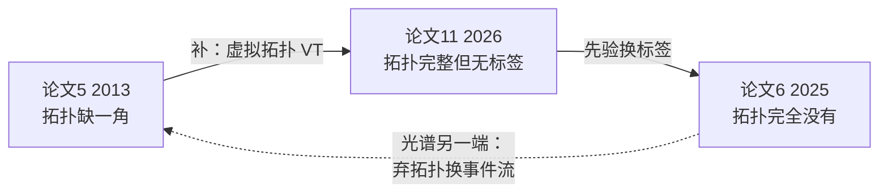
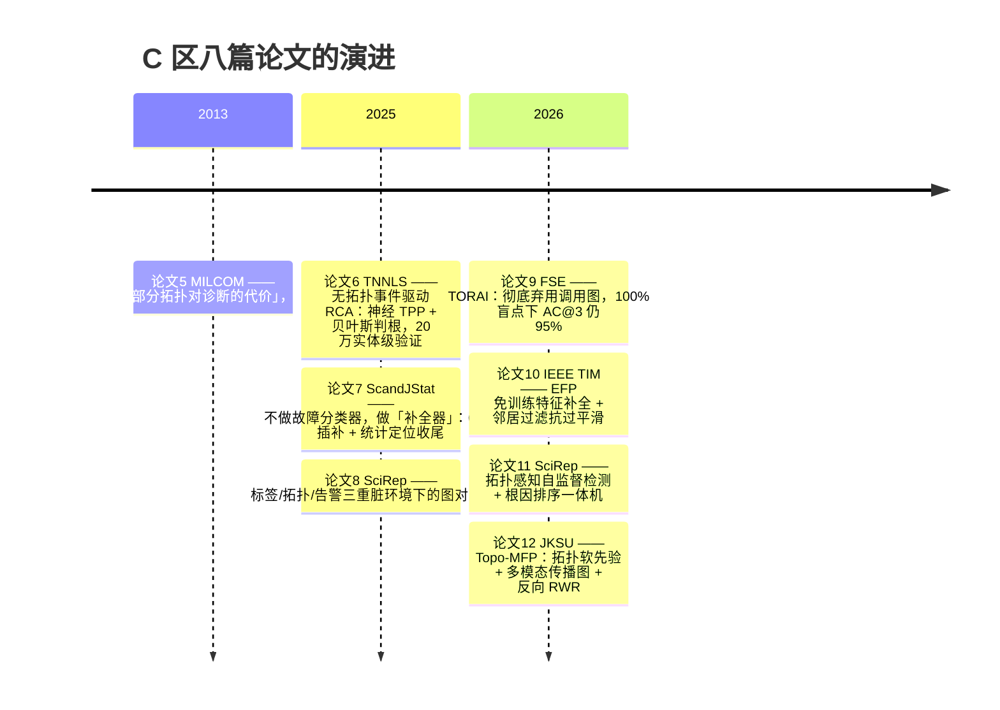

# C 观测或拓扑不完整下的故障诊断与 RCA — 知识图谱

> 本区块回答一个问题：**拓扑残缺、量测稀疏、标签稀缺、trace 有盲点时，故障诊断和根因定位还能不能做？怎么做？**
> 八篇论文、三个场景（C1 拓扑缺失 / C2 电力量测 / C3 微服务）、一条共同主线：**缺什么，就用另一种便宜的信息补什么。**

## 一、八篇论文速览

| # | 论文 | 年份 | 网络对象 | 缺什么 | 核心武器 | 笔记 |
|---|---|---|---|---|---|---|
| 5 | Holbert et al., MILCOM | 2013 | 网络故障诊断 | **拓扑缺一角**（非响应路由器） | [[虚拟拓扑（Virtual Topology）]] 补盲区 + 量化代价 | [[5部分拓扑对故障诊断的影响]] |
| 6 | NetEventCause, TNNLS（华为） | 2025 | 大型网络告警流 | **拓扑完全没有** | ODE-RNN 神经 [[时间点过程（TPP）]] + 贝叶斯判根 + [[归因方法（attribution method）]] | [[6NetEventCause：无拓扑的事件驱动根因分析]] |
| 11 | Luo et al., Scientific Reports | 2026 | 网络运维 KPI | **标签稀缺**（拓扑已知） | 双图分治 [[自监督异常检测]] + 有向传播一致性排序 | [[11拓扑感知自监督KPI异常检测与根因节点定位]] |
| 7 | Rimkus et al., Scand. J. Stat. | 2025 | 输电网 | **节点量测缺失**（PMU 部分覆盖） | RGNN/SIGNN 无标签插补 + BMSE 损失 + 统计定位收尾 | [[7部分可观测输电系统故障定位的图神经网络]] |
| 10 | Sun et al., IEEE TIM | 2026 | 配电网 | **量测稀疏** + 深度过平滑 | [[特征传播（Feature Propagation）|EFP 解析特征传播]] + RGCN-NF 邻居过滤 | [[10稀疏量测配电网故障分类与定位的图方法]] |
| 8 | GCFR, Scientific Reports | 2025 | 电力通信网 | **标签稀缺 + 拓扑漂移 + 告警噪声** | [[图对比学习]] + 时间一致性正则 + 选择性预测 | [[8面向电力通信网络的图对比故障表征学习]] |
| 9 | TORAI, FSE 2026 | 2026 | 微服务 | **trace 盲点**（调用图不完整甚至建不出） | **弃图**：严重度聚类 + [[因果发现（causal discovery）]] + 假设检验 | [[9带盲点的服务调用图根因分析]] |
| 12 | Topo-MFP, JKSU-CS | 2026 | 微服务 | **传播方向不可信**（调用 ≠ 传播） | [[拓扑感知]]软先验多模态传播图 + 反向 [[随机游走重启（RWR）]] | [[12Topo-MFP：拓扑感知多模态传播学习]] |

## 二、三条子线

### C1 拓扑可得性光谱（论文 5 → 11 → 6）

- **论文5** 先泼冷水：仅 5% 非响应节点就明显劣化，故障偏向盲区时 ACC 恒为 0；VT 能救回大部分 ACC，但 **FP 最高达完整拓扑的 24 倍**——「盲区必错、补丁有价」。
- **论文11** 站在「拓扑可得且较准」的假设上：自监督检测 + 拓扑传播先验做定位（A@1=0.76），论文5 恰好是对这个假设的压力测试。
- **论文6** 走到光谱尽头：抹掉实体身份（20 万实体 → 518 种事件类型），神经 TPP 直接从告警流学激发关系（AUC=0.843）——证明「一角都没有也能干」。

### C2 电力场景的「缺什么 × 怎么学」矩阵（论文 7 / 10 / 8）

| 论文 | 对象 | 缺什么 | 补全方式 | 标签范式 |
|---|---|---|---|---|
| 7 | 输电网（122 母线） | 节点**时序轨迹** | 可训练 GNN 回归插补（BMSE 为下游定制） | **零标签** |
| 10 | 配电网（33/119 母线） | 节点**静态特征** | 免训练解析式（Dirichlet 能量最小化） | **标签充足**（可上 6 层深 GNN） |
| 8 | 电力通信网 | **标签** + 拓扑在漂移 + 告警脏 | 不补数据、补表征（对比学习） | **少标签**（1–20%） |

三篇共同直觉：**相邻母线电压相似**（扩散卷积 / Dirichlet 能量 / 邻居过滤都在利用它）——电网图上做插补的物理基础。

### C3 微服务的拓扑哲学对照（论文 9 vs 12）

| | 论文12 Topo-MFP | 论文9 TORAI |
|---|---|---|
| 拓扑立场 | **软先验**（$\rho_{in}/\rho_{out}$ 两档惩罚），用到极致 | **彻底弃用**，容忍 100% 盲点 |
| 前提 | trace 可得、有训练数据 | 有什么用什么（metrics/logs 兜底） |
| 边界条件 | 盲点遍地时依赖图退化成碎片 | 精度上限低于「图好用」的情形 |
| 诚实声明 | 学到的传播图「不是因果图」（全文五遍） | 事件级 RCA 只够「缩小排查范围」 |

两者不矛盾：**trace 覆盖尚可 → Topo-MFP 上限更高；盲点遍地、无标注 → TORAI 更稳**。Topo-MFP 的 Topology-RWR 对照实验（Hit@1 +15/+8 个百分点）同时给出了「拓扑信息值得用」的定量证据。

## 三、总图

```mermaid
graph TB
    HUB["观测或拓扑不完整下的<br/>故障诊断与 RCA"]

    subgraph C1["C1 拓扑可得性光谱"]
        P5["论文5 MILCOM 2013<br/>部分拓扑：盲区必错、VT 补丁有价"]
        P11["论文11 SciRep 2026<br/>拓扑换标签：双图分治自监督"]
        P6["论文6 TNNLS 2025<br/>无拓扑：神经 TPP 事件驱动"]
        VT["虚拟拓扑（Virtual Topology）"]
        TPP["时间点过程（TPP）"]
        SS["自监督异常检测"]
    end

    subgraph C2["C2 电力：量测/标签缺失"]
        P7["论文7 ScandJStat 2025<br/>GNN 插补轨迹，统计收尾"]
        P10["论文10 IEEE TIM 2026<br/>EFP 解析补全 + 残差 GCN"]
        P8["论文8 SciRep 2025<br/>图对比学习 + 选择性预测"]
        EFP["特征传播（Feature Propagation）"]
        GCL["图对比学习"]
        SM["稀疏量测（sparse measurements）"]
    end

    subgraph C3["C3 微服务 RCA"]
        P9["论文9 FSE 2026<br/>TORAI：弃图，容忍盲点"]
        P12["论文12 JKSU 2026<br/>Topo-MFP：拓扑软先验"]
        BS["盲点服务（blind spots）"]
        CD["因果发现（causal discovery）"]
        RWR["随机游走重启（RWR）"]
    end

    BRECON["B 部分：网络重构<br/>（提供图 / 提硬指标）"]
    ACLASSIC["A 部分：经典诊断理论<br/>（冲突→候选→测量）"]

    HUB --> C1
    HUB --> C2
    HUB --> C3

    P5 --> VT
    P5 -->|"MT 实验给重构质量提硬指标"| BRECON
    P6 --> TPP
    P11 --> SS
    P11 -.->|"A_enc / W 是重构产物的消费端"| BRECON

    P7 --> SM
    P10 --> EFP
    P10 -->|"与论文1 图平滑补全同源"| BRECON
    P8 --> GCL
    P7 -.->|"= 论文4 不完整图信号<br/>换下游任务"| BRECON

    P9 --> BS
    P9 --> CD
    P12 --> RWR
    P9 <-->|"正面互衬：<br/>弃图 vs 软先验"| P12

    P7 -.->|"假设检验收尾的<br/>统计缓冲思想"| ACLASSIC
    P9 -.->|"多假设/简约原则"| ACLASSIC

    classDef paper fill:#d0ebff,stroke:#1971c2
    classDef core fill:#e5dbff,stroke:#6741d9
    classDef concept fill:#fff9db,stroke:#f08c00
    class P5,P6,P7,P8,P9,P10,P11,P12 paper
    class HUB,BRECON,ACLASSIC core
    class VT,TPP,SS,EFP,GCL,SM,BS,CD,RWR concept
```

## 四、发展时间线

## 五、贯穿全区块的六个核心洞察

1. **「不完整」是多维的，先诊断自己缺哪个维度**：拓扑（缺一角 / 完全没有 / 方向不可信）、节点信号（量测稀疏）、标签（稀缺 / 零）、数据源（trace 盲点）。选方法前先填这张「缺什么」清单。
2. **先验替代缺失信息**：论文6 用类型级激发先验替代拓扑，论文11 用拓扑先验替代标签，论文12 用拓扑软先验约束传播，论文9 用统计检验替代图——**缺什么，就找另一种便宜的信息补什么**。
3. **处理不完整观测的三档策略**：补图（论文5 VT、论文7 插补、论文10 EFP）→ 学图（论文12 传播图）→ 弃图（论文6、9）。数据越残缺，越往后挪。
4. **无标签学习三式**：插补式回归（7）、对比式表征（8）、重构式自监督（11）——共同点是都不碰故障位置标签。
5. **深度输出与运维决策之间要加统计缓冲**：论文7 用统计定位法收尾、论文8 用熵阈值选择性预测弃权、论文9 用中位数/IQR 假设检验——没有一篇让神经网络直接下诊断结论。
6. **评估诚实度是 C 区的共同气质**：论文12 专门算随机排名基线并警告 Hit@5 饱和，论文9 主动报告盲点敏感性（0–100%），论文11 承认对 DCdetector 优势不显著——这些「防虚高」设计本身就是可迁移的方法论。

## 六、对 AI 运维的映射

| 论文场景 | 运维对应 |
|---|---|
| 非响应路由器 / 虚拟链路 | 服务依赖图中 CMDB 没覆盖的组件、推断出来的依赖——**拓扑覆盖率应作为输入质量 SLA 管理**（论文5） |
| PMU 部分覆盖 / 量测稀疏 | 指标埋点不全的服务：先补全（EFP/GNN 插补），再复用成熟诊断，别硬训端到端分类器（论文7/10） |
| 标签稀缺 + 拓扑漂移 | 故障标注永远不够、服务天天上线：对比学习 + 时间一致性正则 + 不确定就弃权转人工（论文8/11） |
| 告警风暴 + 无拓扑 | 事件驱动 RCA 做第一层兜底，只依赖带时间戳的告警（论文6） |
| trace 盲点 | 新服务/闭源组件没埋点：RCA 方法「有什么用什么」，metrics/logs 的价值被低估（论文9） |
| 调用方向 ≠ 传播方向 | CMDB 依赖当软先验编码进损失，别硬性只在调用图上随机游走（论文12） |

## 七、交互版图谱

双击打开 [[C知识图谱.canvas]]（Canvas 视图，可拖拽、缩放、点节点跳转笔记）。

## 八、素材与概念页

- 本区块 8 篇论文的结构化摘要素材：[[_知识图谱素材_C1论文5-6-11]]（C1 三篇）；论文 7/9/12 的摘要已含在各笔记「与其他论文的关系」节。
- 概念页见本目录 [[部分可观测图（partially observed graph）]]、[[部分可观测网络]]、[[虚拟拓扑（Virtual Topology）]]、[[无拓扑根因分析（topology-free RCA）]]、[[事件驱动RCA]]、[[时间点过程（TPP）]]、[[归因方法（attribution method）]]、[[盲点服务（blind spots）]]、[[调用链（calling chain）]]、[[服务调用图（service call graph）]]、[[拓扑感知]]、[[特征传播（Feature Propagation）]]、[[图对比学习]]、[[自监督异常检测]]、[[稀疏量测（sparse measurements）]]、[[PMU（相量测量单元）]]、[[电力通信网络（PCN）]]、[[多元KPI]]、[[过平滑（oversmoothing）]]、[[随机游走重启（RWR）]]、[[因果发现（causal discovery）]]、[[故障传播建模]]、[[故障分类与定位]]、[[微服务根因分析（microservice RCA）]]、[[告警风暴]]、[[多模态观测（metrics、logs、traces）]]、[[图神经网络（GNN）]] 等。
