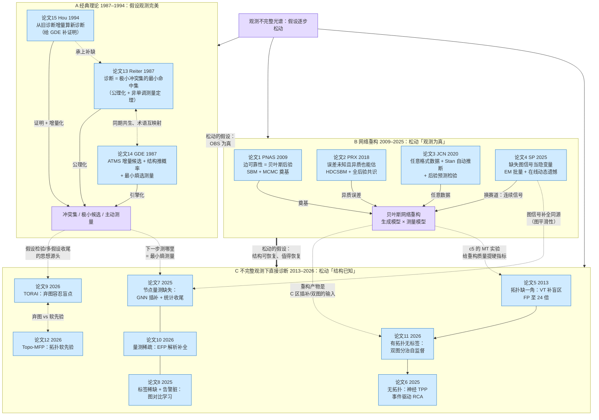
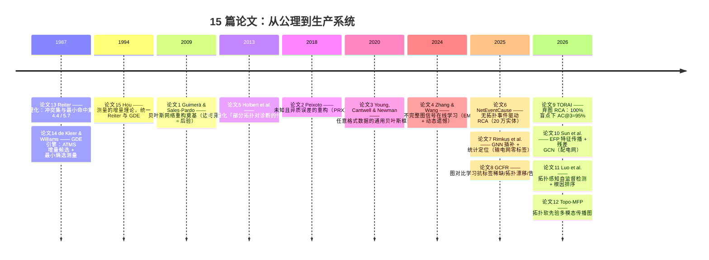

# AI 运维 · 15 篇论文总知识图谱

> 15 篇论文（A 区 3 篇 + B 区 4 篇 + C 区 8 篇）合起来讲了一个故事：
> **从「假设观测完美」到「承认观测天生不完整」，诊断学用了 40 年把这条假设一步步松开。**
> A 给骨架（冲突 → 候选 → 测量），B 修观测（贝叶斯重构），C 拿着残缺观测直接诊断（补图 / 学图 / 弃图）。

## 一、三大区块速览

| 区块 | 论文 | 时代 | 问题设定 | 对「观测」的假设 | 一句话 |
|---|---|---|---|---|---|
| **A 经典诊断与测量理论** | [[13基于第一性原理的诊断理论]]、[[14诊断多重故障]]、[[15第一性原理诊断中的测量理论]] | 1987–1994 | 电路排障 | **SD 完美、OBS 为真**——唯一松动的假设是「部件都正常」 | 定义（Reiter）→ 引擎（GDE）→ 增量测量理论（Hou） |
| **B 网络观测不可靠、重构与不完整图信号** | [[1缺失与虚假交互及复杂网络重构]]、[[2重构具有未知和异质误差的网络]]、[[3从不可靠数据中贝叶斯推断网络结构]]、[[4从不完整图信号中学习图：从批量到在线方法]] | 2009–2025 | 复杂网络 | **观测有误差/缺失，但结构可恢复**——边是假的/漏的，信号是缺的 | 把误差/缺失当隐变量，用结构先验把「真图」从脏数据里抠出来 |
| **C 观测或拓扑不完整下的故障诊断与 RCA** | [[5部分拓扑对故障诊断的影响]]、[[6NetEventCause：无拓扑的事件驱动根因分析]]、[[7部分可观测输电系统故障定位的图神经网络]]、[[8面向电力通信网络的图对比故障表征学习]]、[[9带盲点的服务调用图根因分析]]、[[10稀疏量测配电网故障分类与定位的图方法]]、[[11拓扑感知自监督KPI异常检测与根因节点定位]]、[[12Topo-MFP：拓扑感知多模态传播学习]] | 2013–2026 | 电网 / 通信网 / 微服务 | **不追求恢复完整观测，直接在残缺观测上诊断** | 补图（5/7/10）→ 学图（12）→ 弃图（6/9），标签缺失用自监督/对比学习（8/11） |

## 二、全局总图

## 三、发展时间线

## 四、贯穿 15 篇的六个核心洞察

1. **观测不完整是一门类型学，先分类再选武器**：测量误差（假阴/假阳，B1–3）、信号缺失（MCAR/MAR/MNAR，B4）、拓扑缺失（缺一角/全缺/方向不可信，C5/6/12）、标签缺失（C8/11）、数据源缺失（trace 盲点，C9）。**「没采集到」≠「采集到没有」**（B2）是最容易被忽略的一条。
2. **共同内核：用结构先验换取缺失信息**。误差率不是测出来的，是被 SBM 块结构的异质性「夹住」的（B2 式39–40）；图不是测出来的，是被信号平滑性约束出来的（B4）；传播方向不是拍出来的，是被拓扑软先验 + 多模态证据顶出来的（C12）。**缺失的部分当隐变量，不要拍阈值把数据洗成确定值。**
3. **全后验 vs 点估计，是「要置信度」与「要延迟」的取舍**：B1–3 采全后验给不确定性（MMP 共识 / HMC），B4 与整个 C 区用 MAP/点估计换工程可行性。运维落地的折中：**用点估计干活，把置信度当一等公民往下游传**（B1 的边可靠性、C8 的选择性预测、C12 的候选集随机基线）。
4. **两条互补路线：修观测 vs 降低对观测的依赖**。B 区和 C5/7/10 是「修」——重构/插补/补全；C6/9 是「绕」——彻底不依赖拓扑；C12 居中——拓扑当软先验。数据残缺程度越深，越往「绕」挪。
5. **证据是流式到来的：非单调性与增量性贯穿三个时代**。Reiter 定理 5.7：新测量可能**扩大**候选空间（1987）；Hou：新诊断可以从旧诊断增量算出、且与测量顺序无关（1994）；B4：在线图学习带动态遗憾界（2025）；C9：新告警只重算被推翻的假设。**「重跑全图」永远是下策。**
6. **评估的诚实度决定结论的可信度**：B3 的后验预测检验（p≈0.5 才健康）、B3 的「稀疏网络看 precision 别看假阳性率」、C12 专算随机排名基线并警告 Hit@5 饱和、C9 主动报告 0–100% 盲点敏感性、C11 承认检测优势不显著。**先算随机基线，再谈提升。**

## 五、对 AI 运维的总映射

| 层 | 15 篇给出的答案 |
|---|---|
| **数据管道** | 区分「没采集」与「采集到零」（B2）；警惕 MNAR——故障时恰恰采不到数（B4）；拓扑/trace 数据直接当真 = 偷偷假设它可靠（B1–3） |
| **拓扑治理** | 拓扑覆盖率当输入质量 SLA 管（C5）；推断/虚拟的依赖要显式标注并降权（C5）；CMDB 依赖当软先验编码进损失，调用方向 ≠ 传播方向（C12） |
| **监控埋点** | 最小熵选下一个测量 = 「下一步查哪个服务/打哪个点」（A14）；backward stepwise 布点 = 预算内传感器规划（C7） |
| **异常检测** | 标签稀缺用自监督/对比学习：掩码重构（C11）、图对比（C8）、插补式回归（C7）；检测导向不够，要诊断导向 |
| **根因定位** | 拓扑好用时学传播图 + 反向 RWR（C12）；盲点遍地时弃图走严重度聚类 + 因果 + 假设检验（C9）；无拓扑走事件流 TPP（C6） |
| **根因推理骨架** | 冲突 → 极小候选 → 多假设并存：新告警可能让假设集合变大而非缩小（A13）；增量计算，新证据只重算被推翻的部分（A15） |
| **人机协同** | 不确定就弃权转人工：熵阈值选择性预测（C8）；事件级 RCA 定位为「辅助缩小范围」而非自动闭环（C6） |

## 六、区块入口

- **A 经典诊断与测量理论**[[A-知识图谱|A 区知识图谱]]] · [[A知识图谱.canvas]]
- **B 网络观测不可靠、重构与不完整图信号**[[B-知识图谱|B 区知识图谱]]] · [[B网络观测知识图谱.canvas]]
- **C 观测或拓扑不完整下的故障诊断与 RCA**[[C-知识图谱|C 区知识图谱]]] · [[C知识图谱.canvas]]
- 精读摘要素材：[[_知识图谱素材_B论文2-3-4]]、[[_知识图谱素材_C2+A论文8-10-13-14-15]]、[[_知识图谱素材_C1论文5-6-11]]
- 交互版总图：[[总知识图谱.canvas]]
