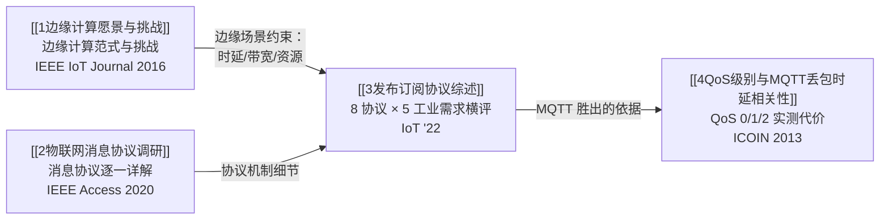

# A 区综述 · 协议基础与场景调研

> 对应任务书**任务 1**（调研 MQTT 等轻量级消息协议与边缘消息中间件研究现状）。四篇论文回答两个问题：**为什么消息中间件要下沉到边缘**（论文1）与**为什么选 MQTT**（论文2/3/4）。
> 思维导图：[[1思维导图.canvas]] · [[2思维导图.canvas]] · [[3思维导图.canvas]] · [[4思维导图.canvas]]；各笔记末尾有「怎么用 & 怎么做」落地清单（Ubuntu 22.04 / 树莓派 / C++）。

## 论文与关系

- [[1边缘计算愿景与挑战]]：定义边缘计算（在网络边缘处理数据），给出响应时延、电池寿命、带宽成本、数据安全四大动机与 edgeOS 分层愿景——这是任务书「传统消息中间件部署臃肿、功耗高」问题的场景出处。
- [[2物联网消息协议调研]]：MQTT/AMQP/DDS/CoAP/HTTP 等协议逐一拆解（broker 模型、exchange 模型、全局数据空间）；Eclipse IoT 调查中 MQTT 采用率居前二。
- [[3发布订阅协议综述]]（IoT '22，ACM）：按互操作/安全/可扩展/实时/可靠五条工业需求横评 8 个协议，结论是**无一全部满足**，且满足度与传输层选择（TCP 保可靠不实时、UDP 潜在实时但可靠性自建）深度绑定；仅 OPC UA 靠数据建模完全满足互操作。
- [[4QoS级别与MQTT丢包时延相关性]]（ICOIN 2013）：首次给出 MQTT 三级 QoS 端到端丢包/时延实测——QoS 等级越高越可靠但越慢，无线 + 大 payload 是丢包主因。它给 B 区的实现选型（任务 3）与 D 区的压力测试（论文11）提供基线。

## 规范资料（协议实现字典）

- [[R1MQTT5.0规范精读]]（`规范R1MQTT5.0/mqtt-v5.0.pdf`，137 页）：报文结构、属性/原因码、QoS 流程、会话过期、流控的逐章精读，末尾给「哪些部分可以等」三档分类——写代码时按此选实现顺序。
- [[R2MQTT3.1.1规范精读]]（`规范R2MQTT3.1.1/mqtt311.pdf`，81 页）：最简语义打底，与 5.0 的差异点已标出。
- 实现顺序建议：先用 3.1.1 语义把 QoS 0/1/2、会话、遗嘱跑通（对应 [[毕设完成流程书]] W8–W12），再按 5.0 笔记的三档分类加会话过期/原因码/属性子集。

## 写文献综述章节的建议顺序

场景（论文1）→ 协议横评（论文3 为主、论文2 补机制细节）→ MQTT QoS 语义与代价（论文4）→ 引出本课题定位（轻量级边缘 broker）。
