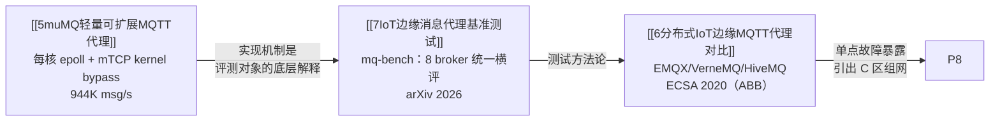

# B 区综述 · 代理实现与性能评测

> 对应任务书**任务 3**（实现发布/订阅模块、QoS 0/1/2）与**任务 6**（连接数/吞吐/时延测试）。三篇论文回答：**单机 broker 内部怎么做**（论文5）与**怎么测、选哪个现成实现**（论文6/7）。
> 思维导图：[[5思维导图.canvas]] · [[6思维导图.canvas]] · [[7思维导图.canvas]]；各笔记末尾有「怎么用 & 怎么做」落地清单（Ubuntu 22.04 / 树莓派 / C++）。

## 论文与关系

- [[5muMQ轻量可扩展MQTT代理]]：瓶颈的迁移路径——Mosquitto 单线程 → 多核事件循环 → 内核 TCP 栈；muMQ 用每核 epoll + 单实例 topic 树读写锁 + mTCP/DPDK 达到 944K msg/s（Mosquitto 的 5.38 倍）、512K 长连接，**代价是只有 QoS 0、无 retained/持久化/离线会话**——轻量与可靠性的取舍实例。
- [[6分布式IoT边缘MQTT代理对比]]（ECSA 2020，ABB）：K8s 边缘集群对称 10+10 场景：EMQX 吞吐最高（MST 28K msg/s，时延 6.4 ms@1K 连接对）、VerneMQ 10K/8.7 ms、HiveMQ 8K/119.4 ms，但 **broker 崩溃测试中只有 HiveMQ 零丢消息**（EMQX 丢 580、VerneMQ 丢 82）；TLS 开销 20–43%。给出六点选型决策指导。
- [[7IoT边缘消息代理基准测试]]（arXiv 2026，UNT + Argonne）：mq-bench 工具对 8 个 broker 统一负载（500→10K 连接对、多档 payload），是任务 6 测试方案的方法论蓝本（负载设计、指标口径、环境控制）。

## 对毕设的映射

任务 3 选型：吞吐优先 → EMQX 系思路；可靠性优先 → HiveMQ 的持久化/会话设计。任务 6 测试设计：直接复用 mq-bench 的变量矩阵（连接数、payload、QoS），并补齐论文6 的故障注入维度（broker 崩溃时的消息丢失计数）。
