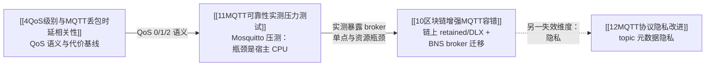

# D 区综述 · 可靠性容错与安全

> 对应任务书**任务 4**（消息持久化、断线重连、遗嘱消息等可靠性保障）。三篇论文覆盖三个失效维度：**broker 进程挂了怎么办**（论文10）、**QoS 的可靠性到底多可靠**（论文11）、**消息内容之外泄露什么**（论文12，扩展素材）。
> 思维导图：[[10思维导图.canvas]] · [[11思维导图.canvas]] · [[12思维导图.canvas]]；各笔记末尾有「怎么用 & 怎么做」落地清单（Ubuntu 22.04 / 树莓派 / C++）。

## 论文与关系

- [[11MQTT可靠性实测压力测试]]（Gaspar et al.）：Mosquitto 在消费级硬件上很健壮——RTT 随 QoS 单调上升（3.38 → 20.06 → 53.45 ms）、丢包单调下降（0.77% → 0.36% → 0.19%）；**性能劣化根因是 broker 宿主 CPU 受限而非协议实现**（CPU 25%→100% 使丢包 43.60%→0.42%）；客户端数是与 RTT 相关性最强的因素（10 客户端是拐点）。注意笔记中标注的两处原文数字存疑（233 µs、秒/毫秒口径）。
- [[10区块链增强MQTT容错]]（SRM）：把 retained messages 队列与 QoS 1/2 死信队列（DLX）搬到区块链智能合约，解除 broker 内存上限；用 **BNS 域名 + 负载均衡在 broker 失效时做 topic 迁移**。思路激进，可作任务 4 的对比方案（工程上用持久化 + 主备 broker 更现实，论文正好说明为什么）。
- [[12MQTT协议隐私改进]]（Fischer et al.）：topic 因 broker 转发需要无法加密，构成元数据泄露面；提出基于 AOTP 解混淆的方案。任务书没有硬性安全条目，作论文「安全与展望」素材。

## 对毕设的映射

任务 4 实现清单可直接从论文11/10 的失效模式反推：持久化（broker 重启不丢 QoS 1/2 在途消息，对标论文6 的崩溃测试口径）、断线重连（会话恢复）、遗嘱消息（客户端异常下线感知）。测试时把论文11 的参数矩阵（QoS × payload × 客户端数 × CPU 配额）作为最低配置。
