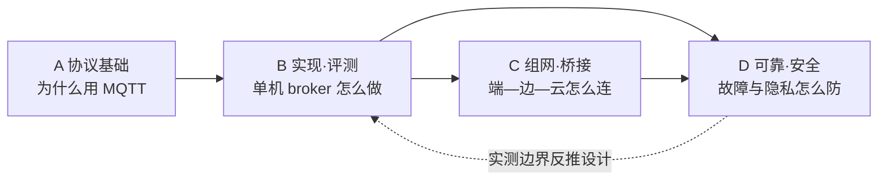

# 论文地图

> 12 篇论文按任务书六条任务分为四个区块（分类依据见 [[毕设任务书总览]]，结构约定见本科毕设/CLAUDE.md）。
> 故事线：**为什么需要边缘轻量中间件（A）→ 单机 broker 怎么实现与评测（B）→ 多 broker 怎么组网桥接（C）→ 可靠性与安全怎么保（D）。**
> 视觉总览：[[毕设知识图谱.canvas]]（四区块 + 每篇「干了什么/核心机制/能用到哪」解说卡）；快速导航用 [[毕设论文总导图.canvas]]；每篇论文另配 `N思维导图.canvas`（入口在各笔记末尾「怎么用 & 怎么做」一节），各区块还有 `X-知识图谱.canvas`。

## 区块速览

| 区块 | 论文 | 一句话 |
|---|---|---|
| **A 协议基础与场景调研**（任务1） | [[1边缘计算愿景与挑战]] · [[2物联网消息协议调研]] · [[3发布订阅协议综述]] · [[4QoS级别与MQTT丢包时延相关性]] | 边缘计算为什么需要轻量协议；MQTT/CoAP/AMQP 等横评；QoS 等级的实测代价 |
| **B 代理实现与性能评测**（任务3、6） | [[5muMQ轻量可扩展MQTT代理]] · [[6分布式IoT边缘MQTT代理对比]] · [[7IoT边缘消息代理基准测试]] | 单机 broker 的实现机制（线程模型/持久化）与基准评测方法论 |
| **C 分布式组网与边云桥接**（任务2、5） | [[8网络边缘分布式MQTT代理消息分发]] · [[9跨组织MQTT桥接架构评估]] | 多 broker 组网的消息分发与边—云桥接拓扑取舍 |
| **D 可靠性容错与安全**（任务4） | [[10区块链增强MQTT容错]] · [[11MQTT可靠性实测压力测试]] · [[12MQTT协议隐私改进]] | broker 故障容错、QoS 可靠性的实测边界、隐私改进 |

## 全局关系

- [[4QoS级别与MQTT丢包时延相关性]]（A）给 [[11MQTT可靠性实测压力测试]]（D）与任务 3 的 QoS 实现提供实测基线。
- [[6分布式IoT边缘MQTT代理对比]]（B）发现的单点瓶颈直接引出 [[8网络边缘分布式MQTT代理消息分发]]（C）的分布式方案。
- [[9跨组织MQTT桥接架构评估]]（C）的桥接拓扑是任务 5「边—云桥接」的直接蓝本。
- [[10区块链增强MQTT容错]]（D）与 [[12MQTT协议隐私改进]]（D）是 broker 故障与安全两个失效维度的对策。

## 目录

- `A协议基础与场景调研/`：A-综述.md + A-知识图谱.canvas + 概念汇总/ + 论文1–4 文件夹
- `B代理实现与性能评测/`：B-综述.md + B-知识图谱.canvas + 概念汇总/ + 论文5、6、7 文件夹
- `C分布式组网与边云桥接/`：C-综述.md + C-知识图谱.canvas + 概念汇总/ + 论文8、9 文件夹
- `D可靠性容错与安全/`：D-综述.md + D-知识图谱.canvas + 概念汇总/ + 论文10、11、12 文件夹
- 可视化总图：`毕设知识图谱.canvas`（四区块 + 12 篇论文 + 任务书六条映射，每张论文卡双击打开精读笔记）
- 概念解释：[[概念索引]]（85 个术语的研0 版解释，按区块分组）
- 任务书整理：[[毕设任务书总览]]
